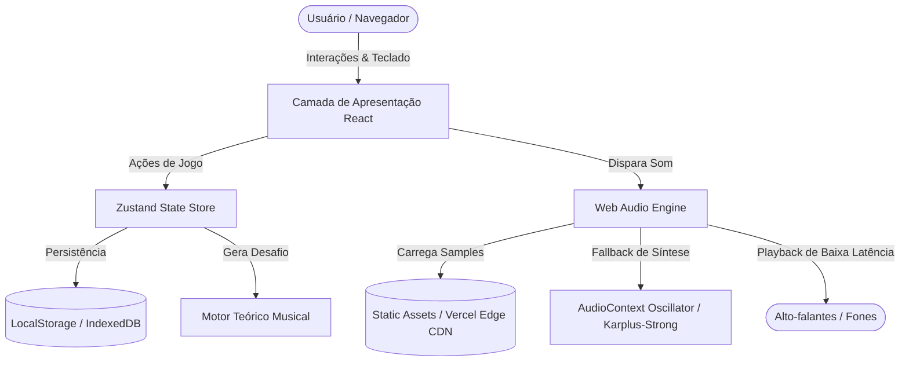
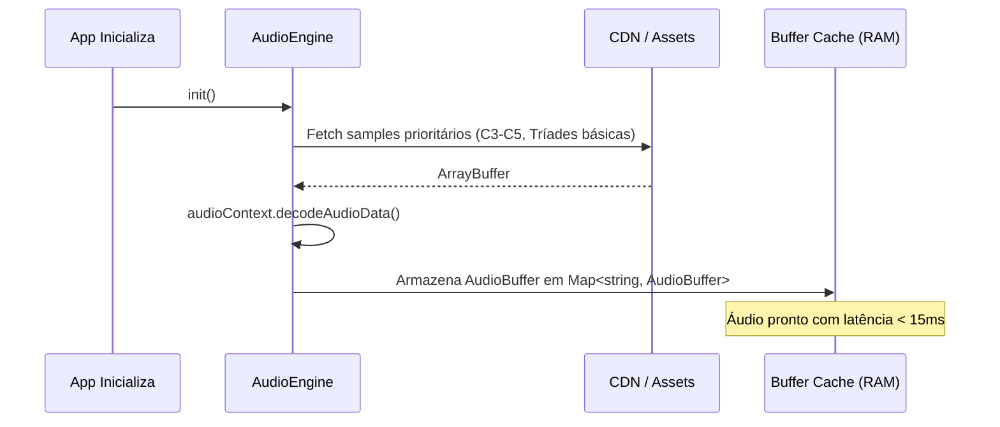

# 🏗️ ARCHITECTURE.md — Arquitetura Técnica do PitchTrainer

Este documento descreve a arquitetura técnica, pipeline de áudio, fluxo de dados e padrões de engenharia de software adotados no **PitchTrainer**.

---

## 1. Visão Geral da Arquitetura

O PitchTrainer é uma aplicação web **Client-First (JAMstack)** construída com **Next.js 15 (App Router)** e **TypeScript**. No MVP, todo o processamento de áudio, geração de desafios e persistência de dados ocorre no cliente (browser), garantindo custo zero de infraestrutura e latência quase imperceptível.



---

## 2. Pipeline e Engenharia de Áudio (Web Audio API)

O áudio é o coração da aplicação. Navegadores modernos impõem restrições rigorosas sobre reprodução de som (como a política de *Autoplay* do Chrome/Safari).

### 2.1 Desbloqueio do `AudioContext` no Primeiro Clique
O navegador inicia o `AudioContext` em estado `suspended`. No primeiro clique do usuário em qualquer botão da tela, o método `AudioEngine.unlock()` é chamado:

```typescript
// Padrão de desbloqueio para iOS / Safari / Chrome
if (this.ctx.state === 'suspended') {
  await this.ctx.resume();
}
```

### 2.2 Estratégia de Carregamento de Amostras (AudioBuffer Preload)
Em vez de usar tags `<audio>` (que têm alta latência e problemas de sobreposição), o PitchTrainer decodifica arquivos `.mp3`/`.ogg` diretamente na memória como `AudioBuffer`:



### 2.3 Fallback de Síntese Acústica (Zero Falha)
Caso o arquivo de áudio falhe ao carregar pela rede, o `AudioEngine` aciona um sintetizador procedural baseado no algoritmo **Karplus-Strong** (síntese física de corda dedilhada) usando nós nativos da Web Audio API (`OscillatorNode`, `GainNode`, `BiquadFilterNode`). O usuário nunca fica sem som.

---

## 3. Schemas de Dados (TypeScript)

### 3.1 Modelos do Domínio Musical (`src/types/music.ts`)

```typescript
export type NoteName = 'C' | 'C#' | 'D' | 'D#' | 'E' | 'F' | 'F#' | 'G' | 'G#' | 'A' | 'A#' | 'B';
export type NoteNamePt = 'Dó' | 'Dó#' | 'Ré' | 'Ré#' | 'Mi' | 'Fá' | 'Fá#' | 'Sol' | 'Sol#' | 'Lá' | 'Lá#' | 'Si';

export type ChordQuality = 'major' | 'minor' | 'dominant7' | 'major7' | 'minor7';

export interface NoteDefinition {
  id: string; // ex: "E2", "A2", "C4"
  note: NoteName;
  octave: number; // 2 a 5
  frequency: number;
  samplePath: string;
}

export interface ChordDefinition {
  id: string; // ex: "C_major", "Am", "G7"
  root: NoteName;
  quality: ChordQuality;
  displaySymbol: string; // ex: "C", "Am", "G7"
  samplePath: string;
}
```

### 3.2 Modelos do Quiz & Sessão (`src/types/quiz.ts`)

```typescript
export type QuizMode = 'notes' | 'chords';

export interface QuizQuestion {
  id: string;
  targetId: string;
  targetLabel: string;
  audioSampleUrl: string;
  options: {
    id: string;
    label: string;
    isCorrect: boolean;
  }[];
}

export interface UserStats {
  totalAnswers: number;
  correctAnswers: number;
  currentStreak: number;
  bestStreak: number;
  streakHistory: number[];
  lastPlayedDate: string;
}

export interface FilterSettings {
  mode: QuizMode;
  includeAccidentals: boolean; // se false, só C, D, E, F, G, A, B
  chordQualities: ChordQuality[]; // ['major', 'minor'] no início
  notationStyle: 'latin' | 'anglo'; // 'Dó, Ré...' ou 'C, D...'
  autoPlayNext: boolean;
  hasTimer: boolean;
  timerDurationSeconds: number;
}
```

---

## 4. Gerenciamento de Estado (Zustand Store)

A biblioteca **Zustand** com o middleware `persist` foi escolhida por ter footprint minúsculo (<1.5kB) e integração perfeita sem boilerplate de Context API.

```
useQuizStore
├── state
│   ├── mode: 'notes' | 'chords'
│   ├── currentQuestion: QuizQuestion | null
│   ├── isAnswered: boolean
│   ├── selectedOptionId: string | null
│   ├── isCorrect: boolean | null
│   ├── stats: UserStats (persistido)
│   ├── filters: FilterSettings (persistido)
│   └── isAudioLoading: boolean
└── actions
    ├── generateNextQuestion()
    ├── submitAnswer(optionId: string)
    ├── replayCurrentAudio()
    ├── updateFilters(newFilters: Partial<FilterSettings>)
    └── resetSessionStats()
```

---

## 5. Estrutura de Componentes

```
<RootLayout>
  ├── <Header>
  │     ├── <LogoWithNoteIcon />
  │     ├── <StreakCounter streak={currentStreak} />
  │     └── <SettingsButton onClick={openSettingsModal} />
  │
  └── <MainQuizContainer>
        ├── <ScoreHud />             {/* Recorde, Acertos, Taxa % */}
        ├── <ModeSwitchTabs />        {/* Notas vs Acordes */}
        ├── <SoundPlayerCard>         {/* Botão de Onda Sonora / Replay */}
        │     └── <WaveformVisualizer />
        ├── <AnswerOptionsGrid>       {/* 4 Cards de Múltipla Escolha */}
        │     └── <OptionCard /> x 4
        └── <FeedbackBottomBanner />  {/* Banner verde/vermelho animado */}
```

---

## 6. Segurança e Performance

1. **Deploy Edge na Vercel**: Todas as rotas estáticas e assets de áudio são servidos com cabeçalhos de cache otimizados (`Cache-Control: public, max-age=31536000, immutable`).
2. **Zero Dados Sensíveis**: No MVP não há senhas, tokens de banco ou PII (dados de identificação pessoal), minimizando riscos de segurança e conformidade (LGPD/GDPR compliance por design).
3. **Bundle Size**: Importações seletivas de ícones da biblioteca `lucide-react` e exclusão de bibliotecas de áudio pesadas legadas.
