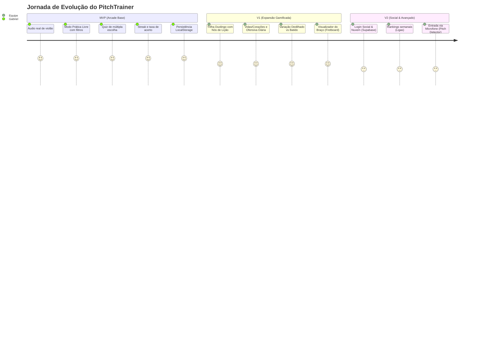

# 📄 PRD — Product Requirements Document

**Produto**: PitchTrainer — Gamified Guitar Ear Training  
**Versão**: 1.0 (MVP)  
**Status**: Aprovado para Implementação  
**Responsável**: Gabriel (Product Owner & Musician)  
**Última Atualização**: 2026-10-12  

---

## 1. Visão do Produto & Contexto

### 1.1 O Problema
Músicos de violão e guitarra enfrentam uma grande barreira no treinamento de percepção auditiva (treino de ouvido):
- A imensa maioria dos apps existentes (ex: Functional Ear Trainer, Teoria.com, Tenuto) utiliza sons de **piano** ou **ondas senoidais/sintetizadores**.
- O ouvido de um violonista/guitarrista se acostuma com as ressonâncias harmônicas de cordas, timbre de madeira/aço/nylon e afinações com múltiplos harmônicos. Músicos têm extrema dificuldade de transpor o som do piano para o violão real.
- Falta de dinâmica e gamificação: softwares tradicionais são cinzas, acadêmicos e monótonos, gerando desistência nos primeiros 7 dias.

### 1.2 A Proposta de Valor
O **PitchTrainer** traz a experiência lúdica, dinâmica e viciante inspirada no **Duolingo** para o universo do violão e da guitarra:
- **Áudio Real de Violão**: Cada nota e acorde é tocado com amostras autênticas de violão.
- **Micro-sessões Rápidas**: Treinos de 2 a 5 minutos com feedback imediato, streak de acertos e sons prazerosos de vitória.
- **Trilhas Especializadas**: Separação clara entre o treino de **Notas Individuais** e o treino de **Acordes (qualidades harmônicas)**.

---

## 2. Personas de Usuário

| Atributo | Perfil Principal: "O Violonista Intermediário" | Perfil Secundário: "O Iniciante Autodidata" |
| :--- | :--- | :--- |
| **Nome** | Lucas, 24 anos | Beatriz, 19 anos |
| **Experiência** | Toca violão há 2 anos, tira músicas por cifra | Começou a tocar guitarra há 4 meses |
| **Dor Principal** | Não consegue tirar músicas de ouvido sem olhar a cifra na internet | Não sabe se o acorde que tocou é Maior ou Menor |
| **Objetivo** | Reconhecer acordes direto da rádio ou jam sessions | Decorar a sonoridade das notas fundamentais |
| **Rotina** | Usa o celular e notebook em pausas de 10 min no dia | Pratica no quarto à noite |

---

## 3. Metas do Produto (Goals vs Non-Goals)

### ✅ Goals (Objetivos do MVP & Fase Pedagógica)
- Permitir que o usuário treine reconhecimento de **Notas Naturais** e **Acidentes** com samples reais de violão.
- Permitir que o usuário treine reconhecimento de **Acordes Maiores, Menores e Tétrades básicas**.
- **Nível 0 (Contorno Melódico)**: Desafio "Subiu ou Desceu?" (⬆️ / ⬇️) para calibrar a audição de altura antes dos nomes de notas.
- **Laboratório de Voz (Zumbido / Humming)**: Guia prático para aprender a casar o tom da voz com as cordas do violão.
- **Escada de Dificuldade de Opções**: Alternância entre 2 opções (Duelo 50/50), 4 opções (Quiz padrão) e Tabuleiro Completo (todas as notas na tela).
- **Módulo de Evolução Diária com Raio-X Isolado**: Calendário de 28 dias mostrando dias ativos, com detalhamento isolado de acurácia, tentativas e recorde por exercício para evitar falsas sensações de piora.
- **Onboarding Pedagógico em 3 Etapas**: Apresentação visual da escada de aprendizado para que o usuário comece do jeito certo.
- Oferecer o **Modo Prática Livre / Arcade** e o **Hub da Jornada Guiada**.
- Fornecer métricas em tempo real: **Streak atual**, **Recorde de streak**, **Pontuação total** e **Taxa de acerto (%)**.
- Persistência 100% local (`localStorage`) sem necessidade de criação de conta.

### 🚫 Non-Goals (Fora do Escopo do MVP)
- Reconhecimento de microfone (escutar o usuário tocando seu próprio instrumento).
- Árvore de unidades com mapa de fases bloqueadas (Duolingo Path) — *definido para a Fase 2 (V1)*.
- Sistema punitivo de perda de vidas/corações (no MVP o treino é contínuo e acolhedor).
- Autenticação e sincronização na nuvem com banco de dados externo.

---

## 4. Matriz de Escopo (MVP vs V1 vs V2)

---

## 5. Requisitos Funcionais Detalhados

### RF01 — Sistema de Áudio e Instrumentos
- **RF01.1**: O app deve reproduzir notas e acordes utilizando amostras autênticas de violão acústico (formato `.mp3` ou `.ogg` comprimido de alta fidelidade).
- **RF01.2**: Deve existir um botão central de **Reouvir Som** (`Replay`) que aciona o áudio instantaneamente com animação visual de ondas sonoras.
- **RF01.3**: O app deve conter efeitos sonoros de interface (SFX) para: acerto (jingle positivo agudo), erro (som grave sutil) e marco de streak (ex: a cada 5 acertos seguidos).

### RF02 — Trilha A: Treinamento de Notas
- **RF02.1**: Permite praticar notas individuais na extensão típica do violão (E2 a E5).
- **RF02.2**: Opções de seleção:
  - *Nível 1 (Básico)*: Apenas Notas Naturais (Dó, Ré, Mi, Fá, Sol, Lá, Si / C, D, E, F, G, A, B).
  - *Nível 2 (Completo)*: Notas Naturais + Acidentes (C#, D#, F#, G#, A#).
- **RF02.3**: Interface de resposta apresenta 4 alternativas em botões táteis (1 correta e 3 distratores aleatórios do mesmo grupo).

### RF03 — Trilha B: Treinamento de Acordes
- **RF03.1**: Permite praticar a sonoridade de acordes reais tocados de uma só vez (batida/strumming cheia).
- **RF03.2**: Subcategorias de filtro:
  - *Tríades*: Maiores (C, D, E, F, G, A, B) vs Menores (Cm, Dm, Em, Fm, Gm, Am, Bm).
  - *Tétrades*: Acordes com 7ª Dominante (ex: G7, C7), 7ª Maior (C7M) e Menores com 7ª (Am7).
- **RF03.3**: Quatro alternativas de resposta em botões claros e legíveis.

### RF04 — Dinâmica de Jogo (Modo Arcade / Prática Livre)
- **RF04.1**: Ao iniciar, o app sorteia um item de acordo com os filtros selecionados e dispara o som automaticamente.
- **RF04.2**: Ao clicar em uma alternativa:
  - Se correta: o botão fica verde com animação de pulso, o som de sucesso toca, o contador de streak sobe +1 e uma nova pergunta surge após 600ms.
  - Se errada: o botão clicado fica vermelho com efeito de tremor (*shake*), o botão com a resposta correta pisca em verde, e o streak volta a 0.
- **RF04.3**: Atalhos de teclado no Desktop:
  - Teclas `1`, `2`, `3`, `4` para selecionar as opções.
  - Tecla `Espaço` ou `R` para reouvir o áudio.

### RF05 — Painel de Métricas (HUD)
- **RF05.1**: Indicador de **Streak Atual** (com ícone de chama que ganha intensidade a partir de 5 acertos seguidos).
- **RF05.2**: **Recorde da Sessão** (Melhor streak atingido).
- **RF05.3**: **Taxa de Acerto (%)**: Percentual de acertos em relação ao total de tentativas da sessão.
- **RF05.4**: Total de notas/acordes identificados hoje.

### RF06 — Painel de Filtros e Configurações
- **RF06.1**: Modal onde o usuário escolhe:
  - Alternar entre Notação Latina (Dó, Ré, Mi...) ou Notação Anglo-saxônica (C, D, E...).
  - Ativar/desativar reprodução automática ao trocar de pergunta.
  - Ativar/desativar timer de resposta opcional (10s por pergunta ou modo livre sem tempo).

---

## 6. Requisitos Não Funcionais

- **RNF01 (Performance de Áudio)**: A latência entre o clique e o som de áudio deve ser inferior a **50ms**. O app deve pré-carregar os buffers de áudio na inicialização.
- **RNF02 (Responsividade)**: A interface deve ser 100% responsiva, funcionando perfeitamente de 360px (smartphones compactos) até 2560px (monitores ultra-wide).
- **RNF03 (Acessibilidade - WCAG 2.1 AA)**: Alto contraste em botões e estados (`#10B981` para acerto, `#EF4444` para erro), suporte completo a navegação por teclado e tags ARIA nos botões de áudio.
- **RNF04 (Persistência)**: As configurações e o recorde de streak devem ser salvos no `localStorage` sem falhas e sem requisições HTTP adicionais.
- **RNF05 (Compatibilidade)**: Suporte aos navegadores modernos (Chrome, Safari iOS, Edge, Firefox).

---

## 7. Métricas de Sucesso

1. **Tempo Médio de Sessão**: Meta > 4 minutos por visita.
2. **Perguntas Respondidas por Sessão**: Meta > 25 desafios concluídos.
3. **Taxa de Retenção Diária**: Meta de retorno no dia seguinte de pelo menos 40% graças à simplicidade do MVP.
